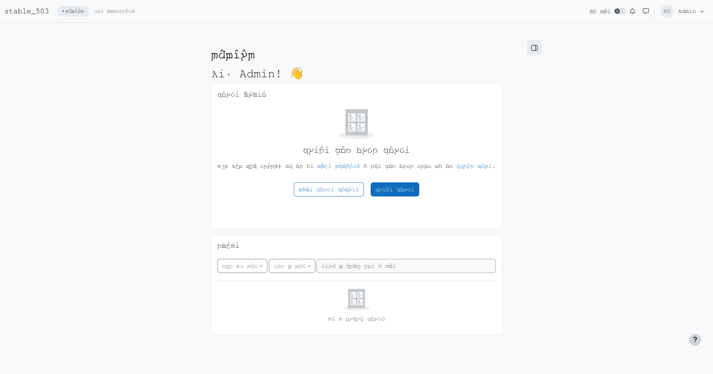

> “And now I think I am quite ready to go on another journey.”
>
> — Bilbo, *The Return of the King*, “The Grey Havens”

# English (Tengwar) for Moodle

In 2016, during a project week at Moodle HQ, I transcribed Moodle into Tengwar to learn how language packs worked. I lost the pack, but the transcriber survived. Ten years later, I'm ready for another journey. Here's the pack again. [The longer story](https://roundhouse.id.au/cameron/tengwar/).

The strings use the [ConScript-based Tengwar encoding](https://freetengwar.sourceforge.net/mapping.html) supported by FreeMonoTengwar. Tengwar letters and marks are stored as Unicode Private Use Area characters, rather than Latin characters repurposed by a font. This is a private-use convention, not an official Unicode allocation for Tengwar.



*Moodle 5.3 using English (Tengwar) with FreeMonoTengwar.*

## Setup

1. Create `$CFG->dataroot/lang/en_teng/` and copy `en_teng/*.php` into it.

2. Download and extract [FreeMonoTengwar](https://freetengwar.sourceforge.net/freemonotengwar.html). Copy `FreeMonoTengwar.ttf` into `$CFG->dataroot/fonts/` (create the folder if needed). With the CSS below, Moodle sends the font to visitors' browsers automatically.

3. In **Site administration → Appearance → Themes → Boost → Advanced settings → Raw SCSS**, add:

   ```scss
   @font-face {
       font-family: "FreeMonoTengwar";
       src: url("[[font:core|FreeMonoTengwar.ttf]]") format("truetype");
       font-display: swap;
   }

   body.lang-en_teng {
       --mds-font-family-base: "FreeMonoTengwar", sans-serif;
       --bs-font-sans-serif: "FreeMonoTengwar", sans-serif;
       --bs-body-font-family: "FreeMonoTengwar", sans-serif;
       font-family: "FreeMonoTengwar", sans-serif;
   }
   ```

4. Go to **Site administration → Development → Purge caches**, then select **English (Tengwar)** under your **Preferences → Preferred language**.

If you get stuck and need English back, add `?lang=en` to your Moodle home URL.

## Firefox tab titles

Moodle's webfont applies to the page, while Firefox uses its own fonts for tab titles. Firefox requires an explicitly named font for Private Use Area characters, so installing the font alone may still leave boxes in the tab title. [Mozilla explains why](https://bugzilla.mozilla.org/show_bug.cgi?id=2014449#c17).

To display Tengwar in Firefox's tabs on your own computer:

1. Install `FreeMonoTengwar.ttf` locally using your operating system's font manager, in addition to putting it in Moodle's fonts directory.

2. Open `about:support` in Firefox and open the **Profile Folder** (called **Profile Directory** on Linux). Inside it, create a `chrome` directory if needed, then add the following to `chrome/userChrome.css`, preserving any existing rules and keeping `@import` statements at the top:

   ```css
   .tab-label {
       font-family: "Noto Sans", "FreeMonoTengwar", sans-serif !important;
   }
   ```

   Replace `Noto Sans` with your usual UI font if different, for example `Segoe UI` on Windows. Keeping that font first preserves ordinary tab text; FreeMonoTengwar supplies the Tengwar glyphs.

3. Open `about:config` and set `toolkit.legacyUserProfileCustomizations.stylesheets` to `true`.

4. Restart Firefox.

This is an optional browser customisation for each user. Firefox updates can change the UI selectors used by `userChrome.css`; see [Mozilla's customisation guide](https://support.mozilla.org/en-US/kb/contributors-guide-firefox-advanced-customization).
